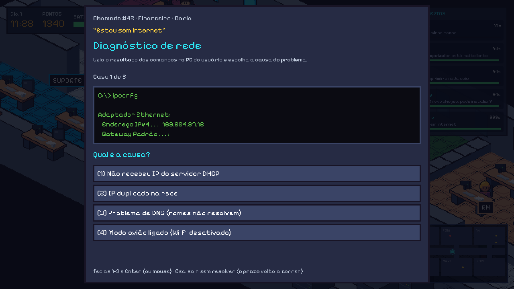
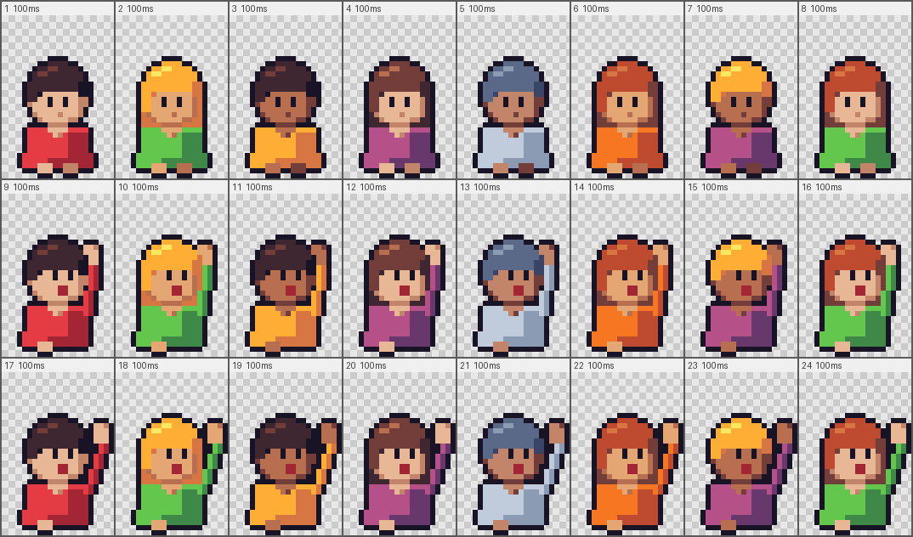

# Chamado Aberto

Jogo 2D educativo em **pixel art isométrica**, feito em **Godot 4.3**. Você é o **técnico de TI** do 7º andar de uma grande empresa: anda pelo escritório **com o teclado**, chega nas mesas com chamado aberto e resolve o problema antes que o prazo (SLA) estoure. Os problemas são os do **dia a dia de um técnico de suporte**.


## Como jogar

| Tecla | Ação |
|---|---|
| `WASD` / setas | andar (as direções seguem a tela: cima = sobe na tela) |
| `E` (ou `Espaço`/`Enter`) | atender o chamado da mesa à sua frente |
| `1`–`9` | escolher opções dentro do atendimento |
| `Enter` | confirmar (quando houver botão principal) |
| `Esc` | sair do atendimento sem resolver |
| `P` | pausa para o café |

- A **seta amarela** em volta do técnico aponta para o chamado mais urgente, e o minimapa mostra todos.
- O prazo do chamado que você está atendendo **para**, mas o dos outros continua correndo.
- Chamados da **Diretoria** têm prioridade alta: prazo menor e mais pontos.
- O expediente vai das 09:00 às 18:00 (5 minutos reais). A cada dia os chamados chegam mais rápido.
- Se a **satisfação dos usuários** zerar, você é chamado na sala do gerente.

## Os chamados



| O usuário diz | Minijogo | O que se aprende |
|---|---|---|
| "Estou sem internet" | ler a saída do `ipconfig`/`ping` e apontar a causa | cabo solto, DHCP (169.254.x.x), DNS, gateway, modo avião, IP duplicado |
| "A impressora não imprime" | ler o painel e aplicar só o que resolve | papel atolado, sem papel, toner, offline, fila travada |
| "Esqueci minha senha" | confirmar a identidade e escolher uma senha válida | política de senha forte e boas práticas de segurança |
| "Meu PC está lento" | Gerenciador de Tarefas: finalizar só o que pesa | não fechar processos do Windows nem o antivírus |
| "Recebi e-mails estranhos" | classificar e-mails como legítimos ou golpe | sinais de phishing |
| "Mudei de mesa e nada funciona" | ligar cada equipamento na porta certa | HDMI, USB, RJ45, P2, VGA e energia |

Os casos são sorteados a cada atendimento e, quando você erra, o jogo explica o porquê.

## Rodando

- **Sem instalar nada:** baixe o executável (Windows/Linux) ou jogue a versão web publicada pelo GitHub Pages.
- **No Godot:** instale o [Godot 4.3](https://godotengine.org/download), importe o `project.godot` e aperte **F5**.

### Testes (headless)

```bash
godot --headless --path . --import
godot --headless --path . -s tests/test_logic.gd
godot --headless --path . -s tests/test_game.gd
godot --headless --path . -s tests/test_camera.gd
```

- `test_logic.gd`: política de senha e consistência dos dados dos chamados.
- `test_game.gd`: abre cada tipo de chamado e o resolve **pelo teclado**, inclusive com um erro proposital; testa fim do dia e fim de jogo.
- `test_camera.gd`: segura as setas e mede, quadro a quadro, que o técnico fica fixo na tela e o cenário rola sem tremer.

## Pixel art

Toda a arte é original e desenhada **pixel a pixel por scripts** com a biblioteca do
[pixel-art-studio](https://github.com/Gamezxz/pixel-art-studio) (MIT, incluída em `art/_lib/`).
Cada asset tem um `build.py` que é a fonte da arte; os PNGs em `assets/sprites/` são gerados:

```bash
pip install pillow
python3 art/technician/build.py    # técnico: 3/4 frente e costas, 4 quadros de caminhada
python3 art/employees/build.py     # 8 funcionários sentados + cadeira
python3 art/office/build.py        # mesas, racks, planta, bebedouro, balões e pisos isométricos
```

Regras seguidas: paleta única **endesga32**, luz do alto-esquerda, contorno de 1 px, rampas com
deslocamento de matiz, sem pixels soltos e escala sempre inteira (o mundo é renderizado em
640×360 e ampliado 2× com filtro *nearest*). A mobília é gerada a partir da pegada em unidades
de mundo, então o desenho bate com a colisão.

| Técnico | Funcionários |
|---|---|
|  |  |


## Estrutura

```
scenes/main.tscn              mundo (SubViewport 640x360), HUD, atendimento e menus
scripts/main.gd               fluxo do jogo (título, expediente, atendimento, fim do dia)
scripts/ticket_system.gd      fila de chamados, relógio, SLA e satisfação (sem UI)
scripts/office_map.gd         andar: salas, mesas, colisão e desenho isométrico ordenado por profundidade
scripts/player.gd             técnico controlado pelo teclado (direções da tela → mundo)
scripts/guide.gd              seta para o chamado mais urgente
scripts/minimap.gd            minimapa
scripts/helpdesk.gd           conteúdo e regras dos chamados (testados)
scripts/tasks/task_base.gd    base dos minijogos (teclas 1–9 / Enter)
scripts/tasks/task_*.gd       os seis minijogos
art/                          scripts que geram a pixel art (fonte dos sprites)
assets/sprites/               sprites gerados
resources/theme.tres          tema da interface (pixel)
fonts/                        Pixelify Sans (licença OFL)
tests/                        testes headless e gerador de capturas
```
