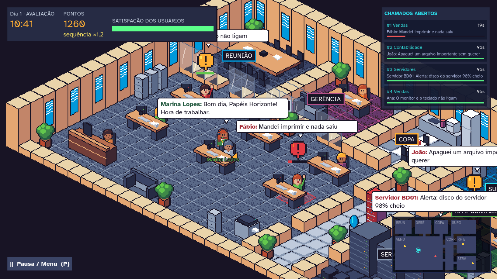
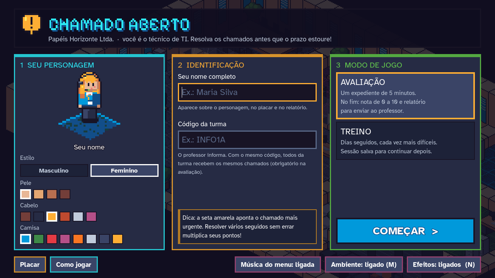
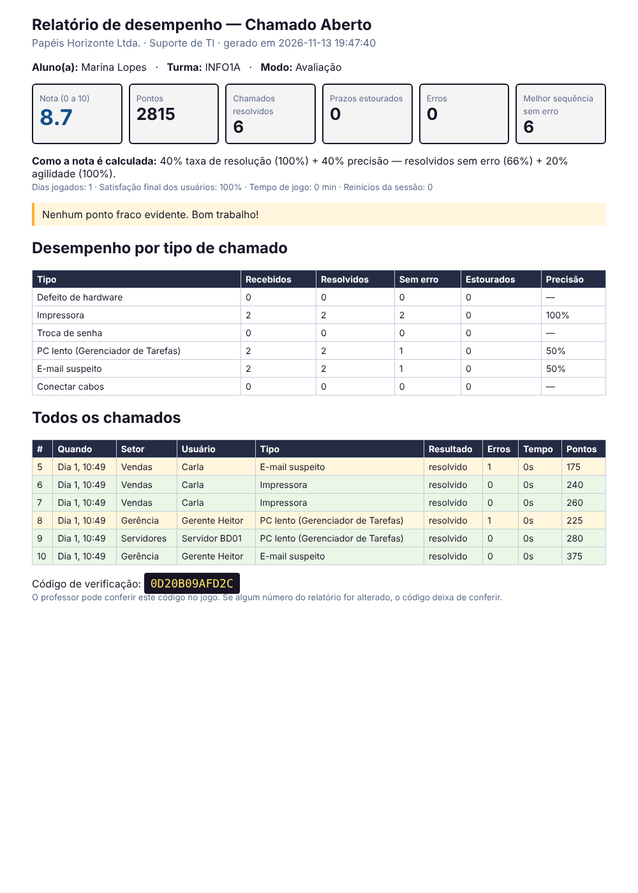
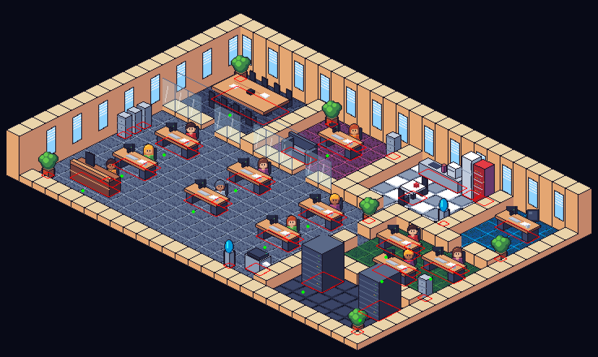
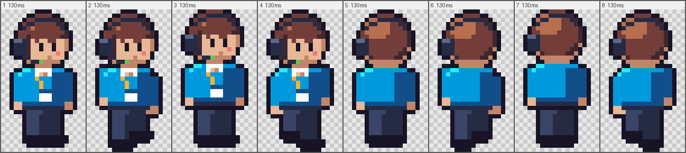
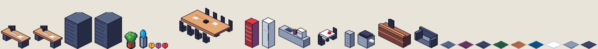

# Chamado Aberto

Jogo 2D educativo em **pixel art isométrica**, feito em **Godot 4.3**. Você é o **técnico de TI** da *Papéis Horizonte Ltda.*, um escritório de vendas com área aberta, sala do gerente com parede de vidro, sala de reunião, copa, corredor, anexo de RH e contabilidade, sala de servidores e a sala do Suporte TI com bancada de manutenção: anda pelo escritório **com o teclado**, chega nas mesas com chamado aberto e resolve o problema antes que o prazo (SLA) estoure. Os problemas são os do **dia a dia de um técnico de suporte**, no nível do 1º semestre do curso técnico em informática.



| Tela inicial | Relatório |
|---|---|
|  |  |

<details><summary>Mapa do andar inteiro</summary>



</details>

## Como jogar

| Tecla | Ação |
|---|---|
| `WASD` / setas | andar (as direções seguem a tela) |
| `E` (ou `Espaço`/`Enter`) | atender o chamado da mesa à sua frente |
| `1`–`9` / `Enter` | escolher e confirmar dentro do atendimento |
| `Esc` | sair do atendimento sem resolver |
| `P` | pausa · `M` liga/desliga o som ambiente · `N` liga/desliga os efeitos |

- O **menu** tem uma **música original em 8 bits** (botão "Música do menu" para desligar); durante o jogo toca um **som ambiente de escritório** (gravação). Música, ambiente e efeitos têm chaves separadas e a escolha fica salva.
- Na tela inicial o aluno digita o **nome**, o **código da turma** e escolhe o **estilo (masculino ou feminino)**, **pele, cabelo e camisa** do personagem.
- **Treino**: expedientes seguidos, a sessão é **salva** no início de cada dia (botão *Continuar*).
- **Avaliação**: um expediente (5 min), no fim aparece a nota e o botão **Baixar relatório**.
- Quem abre um chamado **levanta a mão e acena**, ganha um **"!" grande** sobre a cabeça e um destaque pulsante no chão; os funcionários falam em **balões**.
- O botão **Pausa / Menu** (ou `P`/`Esc`) pausa o jogo; na pausa dá para **voltar ao menu inicial** (a sessão continua salva).

## Pontuação e avaliação

| Evento | Pontos |
|---|---|
| Chamado resolvido | 100 |
| Rapidez | até +100 (proporcional ao prazo que sobrou) |
| Chamado da Gerência | +50 |
| Cada erro no atendimento | −10 |
| Sequência sem erros | multiplica ×1,1 … ×1,5 |
| Prazo estourado | −20 |

**Nota de 0 a 10** = 40% taxa de resolução + 40% precisão (resolvidos sem erro) + 20% agilidade.

- Com o **mesmo código de turma**, todos os alunos recebem a **mesma sequência de chamados** (avaliação justa).
- O relatório (HTML, abre em qualquer navegador e imprime em PDF) traz nota, pontos, desempenho por tipo, todos os chamados, pontos fracos, número de reinícios da sessão e um **código de verificação**.
- O professor abre **[verificar.html](https://cimiano2.github.io/chamado-aberto/verificar.html)**, seleciona os relatórios recebidos e vê o **ranking da turma** e se algum foi **alterado**. Nada é enviado para a internet.
- Na web, o relatório é baixado pelo navegador; no executável, é salvo em *Documentos*.

## Os chamados


| O usuário diz | Minijogo | O que se aprende |
|---|---|---|
| "Meu PC não liga direito" | ler o sintoma e descobrir a peça com defeito | memória RAM, fonte, cabo de vídeo, cooler, bateria da placa-mãe, HD, teclado |
| "A impressora não imprime" | ler o painel e aplicar só o que resolve | papel atolado, sem papel, toner, offline, fila travada |
| "Esqueci minha senha" | confirmar a identidade e escolher uma senha válida | política de senha forte e boas práticas de segurança |
| "Meu PC está lento" | Gerenciador de Tarefas: finalizar só o que pesa | não fechar processos do Windows nem o antivírus |
| "Recebi e-mails estranhos" | classificar e-mails como legítimos ou golpe | sinais de phishing |
| "Mudei de mesa e nada funciona" | ligar cada equipamento na porta certa | HDMI, USB, RJ45, P2, VGA e energia |
| "Apaguei um arquivo sem querer" | escolher como recuperar | Lixeira, versões anteriores, backup, busca, documentos não salvos |
| "Preciso instalar um programa" | clicar nos passos na ordem e evitar armadilhas | site oficial, requisitos, administrador, sem crack nem "extras" |
| "Aparece disco cheio" | marcar só o que pode ser apagado | temporários, lixeira, cache × documentos e pastas do sistema |
| "Não consigo abrir o arquivo" | escolher o programa pela extensão | .docx, .xlsx, .pptx, .pdf, .png, .mp4, .zip, .txt, .csv, .odt |
| "Quero aprender atalhos" | escolher o atalho certo | Ctrl+C/V/X/Z/S/P/A/F, Win+L, Alt+Tab, Ctrl+Shift+Esc... |

São **11 tipos** de chamado. O sorteio evita repetir o mesmo tipo nos 4 chamados seguintes, e dentro de cada tarefa os casos vistos recentemente ficam de fora. Quando você erra, o jogo explica o porquê.

## Rodando

- **Sem instalar nada:** baixe o executável (Windows/Linux) ou jogue a versão web publicada pelo GitHub Pages.
- **No Godot:** instale o [Godot 4.3](https://godotengine.org/download), importe o `project.godot` e aperte **F5**.

### Testes (headless)

```bash
godot --headless --path . --import
godot --headless --path . -s tests/test_logic.gd
godot --headless --path . -s tests/test_game.gd
godot --headless --fixed-fps 60 --path . -s tests/test_camera.gd
```

- `test_logic.gd`: política de senha e consistência dos dados dos chamados.
- `test_game.gd`: confere o cenário (nada fora das salas, portas livres, toda mesa alcançável), abre cada tipo de chamado e o resolve **pelo teclado**, inclusive com um erro proposital; testa fim do dia e fim de jogo.
- `test_camera.gd`: segura as setas e mede, quadro a quadro, que o técnico fica fixo na tela e o cenário rola sem tremer.
- `scale_check.gd` (com janela): captura menu e jogo em várias resoluções (1366x768, 1920x1080...).
- `profile.gd` (com janela): anda pelo escritório e mostra FPS, tempo de desenho e *draw calls*.

**Desempenho:** piso e paredes do fundo ficam numa camada estática (desenhada uma vez), e todos os sprites do mundo vêm de um único atlas, então a placa de vídeo desenha o andar inteiro em ~30 chamadas por quadro.

## Pixel art

Toda a arte é original e desenhada **pixel a pixel por scripts** com a biblioteca do
[pixel-art-studio](https://github.com/Gamezxz/pixel-art-studio) (MIT, incluída em `art/_lib/`).
Cada asset tem um `build.py` que é a fonte da arte; os PNGs em `assets/sprites/` são gerados:

```bash
pip install pillow
python3 art/technician/build.py    # técnico e técnica: 3/4 frente e costas, 4 quadros de caminhada
python3 art/employees/build.py     # 8 funcionários sentados + cadeira
python3 art/office/build.py        # mobília (mesas, reunião, copa, copiadora, recepção...) e pisos
python3 art/sfx/build.py           # efeitos sonoros e música original do menu (síntese, sem samples)
python3 art/atlas/build.py         # junta os sprites do mundo em atlas.png (rode por último)
```

Regras seguidas: paleta única **endesga32**, luz do alto-esquerda, contorno de 1 px, rampas com
deslocamento de matiz, sem pixels soltos e escala sempre inteira: o mundo é ampliado 2×, 3×, 4×...
conforme a altura da tela, medida em pixels reais, com filtro *nearest*. Assim o cenário não treme ao
rolar em nenhuma resolução (1366×768, 1920×1080, zoom de 125% do Windows...). A interface usa
fonte comum suavizada, legível em qualquer escala. A mobília é gerada a partir da pegada em unidades
de mundo, então o desenho bate com a colisão.

| Técnico | Funcionários |
|---|---|
|  |  |



## Estrutura

```
scenes/main.tscn              mundo (SubViewport 640x360), HUD, atendimento e menus
scripts/main.gd               fluxo do jogo (título, expediente, atendimento, fim do dia)
scripts/ticket_system.gd      fila de chamados, relógio, SLA e satisfação (sem UI)
scripts/office_map.gd         andar: salas, mesas, colisão e desenho isométrico ordenado por profundidade
scripts/player.gd             técnico controlado pelo teclado (direções da tela → mundo)
scripts/guide.gd              seta para o chamado mais urgente
scripts/minimap.gd            minimapa
scripts/menu.gd               tela inicial: nome, turma, skin, modo, continuar, placar
scripts/skins.gd              recoloração do técnico (pele, cabelo, camisa)
scripts/save_game.gd          sessão salva e placar local
scripts/report.gd             relatório HTML com código de verificação
scripts/balloons.gd           balões de fala sobre os personagens
scripts/audio.gd              sons e música
web/verificar.html            página do professor: confere relatórios e monta o ranking
scripts/helpdesk.gd           conteúdo e regras dos chamados (testados)
scripts/tasks/task_base.gd    base dos minijogos (teclas 1–9 / Enter)
scripts/tasks/task_*.gd       os seis minijogos
art/                          scripts que geram a pixel art (fonte dos sprites)
assets/sprites/               sprites gerados
resources/theme.tres          tema da interface (pixel)
fonts/                        Atkinson Hyperlegible (textos) e Pixelify Sans (logotipo), licença OFL
assets/audio/                 som ambiente de escritório (ver Créditos)
tests/                        testes headless, gerador de capturas e visão geral do andar (overview.gd)
```

## Créditos

- Música do menu: composição original para este jogo, gerada por síntese em `art/sfx/build.py` (`menu_theme`).

- Som ambiente de escritório: "ambiente escritorio ok.wav", por *freesound_community* no Pixabay
  (licença de conteúdo do Pixabay). O arquivo foi convertido para OGG, normalizado e ganhou uma
  emenda em crossfade para tocar em loop.
- Fonte dos textos: Atkinson Hyperlegible (Braille Institute), feita para leitura fácil; licença SIL OFL (fonts/OFL-AtkinsonHyperlegible.txt).
- Fonte do logotipo: Pixelify Sans, licença SIL Open Font License (fonts/OFL-PixelifySans.txt).
- Biblioteca de pixel art: pixel-art-studio (MIT, art/_lib/).
